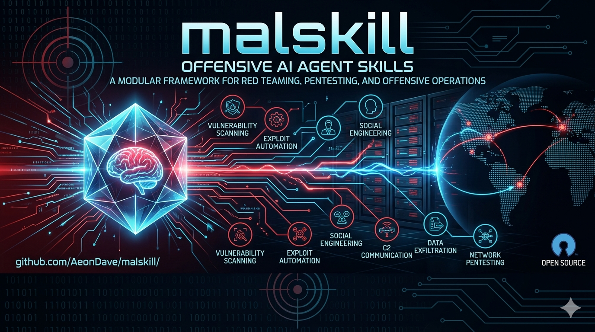

Full-spectrum security skill collection for AI agents, built on the open [AgentSkills](https://agentskills.io) specification.

Each skill is a self-contained folder whose `SKILL.md` gives an agent deep domain knowledge: command syntax, real workflows, decision logic, edge cases, and operational caveats. The collection spans offensive tool execution, exploitation and post-exploitation, credential attacks, defensive artifact and malware analysis, private CTF/lab solving, and offensive tool development - the perspectives a single security task switches between.

Offensive security comes first. Support areas (`coding/`, `coding-behaviours/`, `knowledge/`, `harness-dev/`, `behaviours/`, `ai/`, `hardware/`) belong here only when they directly improve the active security task.

## Skill anatomy

- `SKILL.md` - baseline workflow, routing, and task guidance.
- `references/` - load-on-demand deep dives for specific subtasks; they extend the parent skill and should not act as README-style overviews, training material, or design rationale.
- A skill's `scripts/` - deterministic helpers for its task. Repository maintenance lives separately in the root `scripts/`.
- `assets/` - templates or static supporting material.

---

## Categories

Category details and selected skills live in **[CATALOG.md](CATALOG.md)**. High-level map:

### Offensive

| Category | What it covers |
|---|---|
| [`offensive-tools/`](CATALOG.md#offensive-tools---attack-tool-skills) | One skill per tool by attack phase: flags, scenarios, output parsing, OPSEC |
| [`offensive-coding/`](CATALOG.md#offensive-coding---offensive-development-skills) | Building offensive tooling: shellcode, loaders, BOFs, syscalls, evasion, OS internals |
| [`offensive-techniques/`](CATALOG.md#offensive-techniques---methodology-and-tradecraft-skills) | Tool-agnostic methodology, decision flow, and campaign design |
| [`offensive-roles/`](CATALOG.md#offensive-roles---supervisor-and-operator-role-skills) | Supervisor and vertical-operator roles that compose techniques and tools |
| [`offensive-ctf/`](CATALOG.md#offensive-ctf---private-offensive-ctf-and-lab-solving-skills) | Flag-style and private-lab solving workflows, routed by artifact |
| [`offensive-hardware/`](CATALOG.md#offensive-hardware---hardware-focused-assessments) | On-device compromise, firmware extraction, signal reversing |

### Support

Load these only when they directly serve the active security task.

| Category | What it covers |
|---|---|
| [`coding/`](CATALOG.md#coding---language-patterns-and-tooling) | Idiomatic patterns, testing, and performance for security-tooling languages |
| [`coding-behaviours/`](CATALOG.md#coding-behaviours---engineering-discipline-skills) | Architecture, scoped edits, TDD, testing reliability, systematic debugging |
| [`knowledge/`](CATALOG.md#knowledge---research-and-meta-skills) | Skill authoring, research helpers, doc automation |
| [`knowledge-offensive/`](CATALOG.md#knowledge-offensive---assessment-research-and-evidence) | Vulnerability research and assessment coverage, CVE inventory, PoC review, security prompts, multi-agent coordination |
| [`harness-dev/`](CATALOG.md#harness-dev---agent-harness-development) | Vendor-specific agent and extension authoring |
| [`behaviours/`](CATALOG.md#behaviours---cognitive-discipline-skills) | Cross-cutting operating stances: evidence gates, loop control, input hygiene |
| [`ai/`](CATALOG.md#ai---ai-framework-skills) | ML framework patterns for security models and adversarial workflows |
| [`hardware/`](CATALOG.md#hardware---embedded-and-maker-platform-support) | Dev-board bring-up, comms modules, sensor interfacing |

---

## Quick start

Install from GitHub with the [Skills CLI](https://github.com/vercel-labs/skills):

```bash
# Install the whole collection for your agent
npx skills add AeonDave/malskill -g

# List skills without installing
npx skills add AeonDave/malskill --list

# Install one skill for a specific agent
npx skills add AeonDave/malskill -g --skill adaptixc2-dev --agent codex
```

The CLI discovers the nested layout; add `--full-depth` if a nested skill is hidden by a container.

Or clone and use the local installers:

```bash
git clone https://github.com/AeonDave/malskill.git && cd malskill

# Interactive install (pick skills, destination, format, layout)
./install.sh                     # Bash
pwsh -File ./install.ps1         # PowerShell 7

# Copy a single skill manually
cp -r offensive-tools/windows/mimikatz ~/.agents/skills/

# Unattended: explicit skills, format, layout, destination
./install.sh --skills offensive-tools/windows/mimikatz --format folder --layout group --destination ~/.agents/skills
```

The interactive selector uses arrow keys to navigate, Space to (de)select, `A` for the whole subtree, `C` to continue, and `Q`/`Esc` to cancel; `[x]` is fully selected and `[.]` partially. Local installers need Python 3.10+ with PyYAML and PowerShell 7 (`pwsh`).

Skills are plain folders with no build step - copying one into your agent's skills directory activates it. Output **formats**: `folder` (directory), `.skill` (distributable zip), `zip`. Install **layouts**: `flat` (all under root) or `group` (preserve the category tree).

To update installed skills, delete the old malskill folders from the agent's skills directory and reinstall the latest version.

---

## Repository maintenance

Project maintenance tools live in the root `scripts/` (shared by contributors and installers, not bundled inside any skill); regression tests live in `tests/`. Frontmatter validation and packaging need Python 3.10+ with PyYAML.

```bash
# Scaffold a skill only when an existing one cannot cover the task
python scripts/init_skill.py my-skill --path knowledge --resources references

# Validate a single skill's frontmatter
python scripts/quick_validate.py offensive-tools/windows/mimikatz

# Validate every skill in the repo
python scripts/validate_all.py .

# Sweep for broken links, placeholders, and workstation-path leaks
python scripts/sweep_skills.py offensive-tools/windows/mimikatz

# Check changed files for final newlines and git diff whitespace issues
python scripts/check_changed_files.py

# Summarize v5 x64 Windows survey logs as diagnostic numerical evidence
python scripts/summarize_windows_survey.py /path/to/results > survey.csv

# Package a skill into a .skill archive
python scripts/package_skill.py offensive-tools/windows/mimikatz
```

Validate each changed skill, sweep the affected category when several change, and finish with the changed-file check. Structural checks do not prove workflow quality - review the instructions for substantive behaviour changes. Keep the categories and commands in this README and [CATALOG.md](CATALOG.md) synchronized with the tree.

---

Placement rules and contribution conventions live in [AGENTS.md](AGENTS.md).
